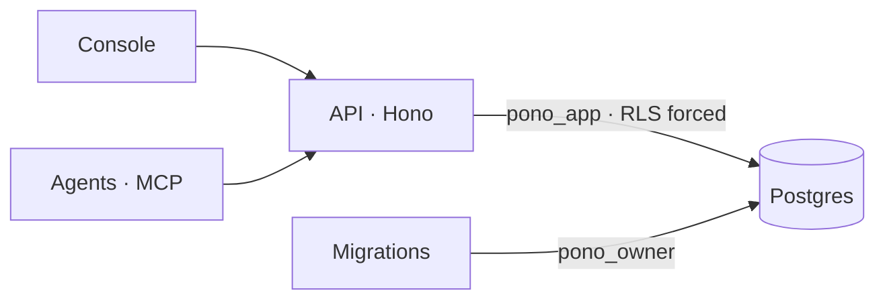

# @pono/api

Pono's API (D-002): the one door for the console, MCP and agents. Hono on Node, Postgres through
`pg`, Zod at every edge.



## Layout

```
src/app.ts              createApp(deps): routes and errors ({ error: { code, message } })
src/main.ts             starts the server
src/platform/           config (Zod), db (pools, withOrganization), migrate, errors
src/features/<feature>/ one vertical slice each, used only through its index.ts
migrations/NNNN_*.sql   applied in order, once, each in a transaction, by the owner role
```

## The organization boundary

Every organization table forces row-level security in the migration that creates it. The API works
inside `withOrganization(pool, id, work)`, which sets `pono.organization_id` for one transaction;
without it, organization tables show nothing. An organization is created only by
`create_organization(name, person)`, with its first owner.

## Run

```bash
pnpm dev:api      # needs PONO_DATABASE_URL (.env.example)
pnpm db:migrate   # needs PONO_DATABASE_OWNER_URL
pnpm test         # starts a local Postgres 17, or uses PONO_TEST_DATABASE_URL
```
